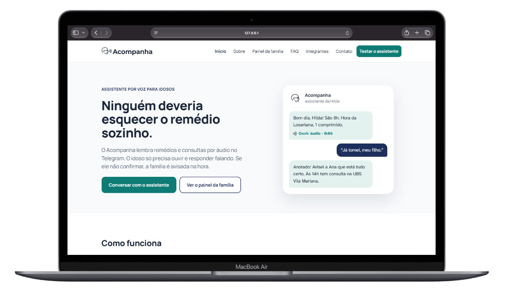
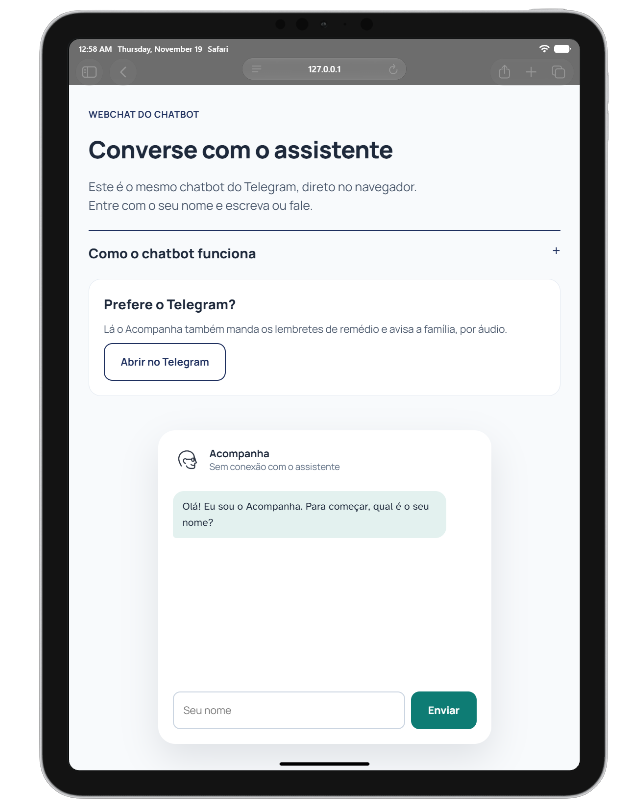
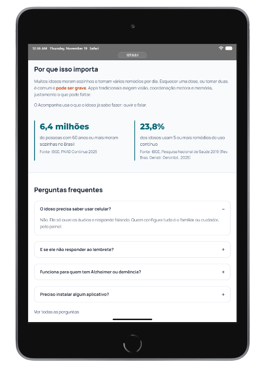
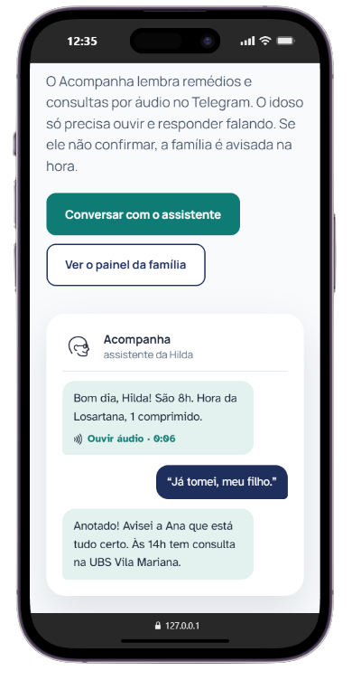
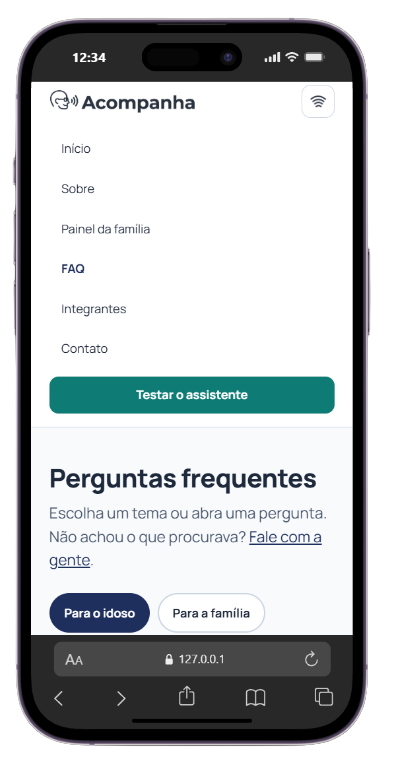
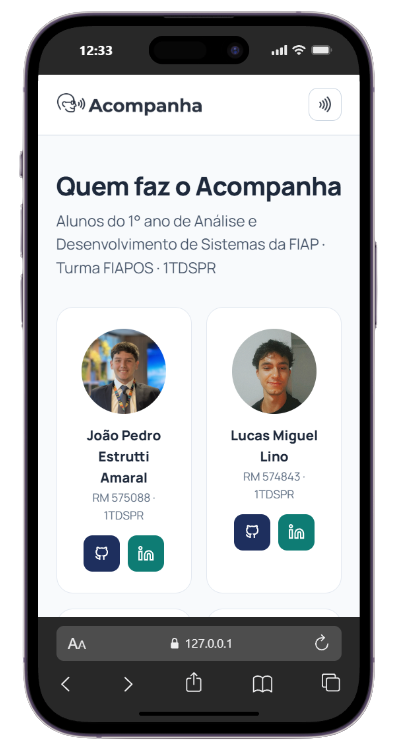

# 🩺 Acompanha — Assistente por Voz para Idosos

> **Tecnologia que fala a língua de quem mais precisa de cuidado.**
> Projeto desenvolvido pela equipe **FIAPOS** (Turma **1TDSPR** — Análise e Desenvolvimento de Sistemas, FIAP) para a **Global Solution 2026**, com a temática **CitizenTech**: *"Tecnologia com o cidadão no centro da inovação"*.

## 📋 Sobre o Projeto

Muitos idosos que moram sozinhos precisam administrar diversos medicamentos diariamente. Esquecer uma dose, ou tomá-la em duplicidade, é um risco frequente, e aplicativos tradicionais exigem boa visão, coordenação motora fina e memória.

O **Acompanha** resolve esse problema invertendo a lógica de uso:
* **Para o idoso:** zero botões pequenos ou digitação. Ele recebe lembretes de medicamentos e consultas por **áudio no Telegram** e confirma tudo falando.
* **Para o familiar ou cuidador:** toda a configuração (remédios, horários, consultas e contatos) é feita pelo navegador. Se o idoso não confirmar em até 30 minutos, ou der uma resposta confusa, a família recebe um alerta e pode acompanhar o histórico semanal (ex.: *"esqueceu 3 vezes esta semana"*).

### 🌍 Alinhamento com os ODS (ONU)
* **ODS 3:** Saúde e bem-estar
* **ODS 10:** Redução das desigualdades


## 🖥️ Páginas
| Página | Arquivo | Conteúdo |
| :--- | :--- | :--- |
| **Início** | `index.html` | Identificação da solução, exemplo de conversa no Telegram, "Como funciona", "Por que isso importa" e prévia da FAQ. |
| **Sobre** | `sobre.html` | Problema, objetivo, proposta, público-alvo e tecnologias da solução. |
| **FAQ** | `faq.html` | Perguntas frequentes em acordeão, com filtro por tema (para o idoso, para a família e sobre o projeto). |
| **Integrantes** | `integrantes.html` | Nome completo, RM, turma, foto, GitHub e LinkedIn de cada integrante. |
| **Contato** | `contato.html` | E-mail da equipe, link do repositório e formulário (nome, e-mail, assunto e mensagem) com validação em JavaScript. |
| **Painel da família** | `painel.html` | *Página da solução 1*: resumo do dia, lembretes de hoje com filtro, gráfico dos últimos 7 dias e alerta de dose não confirmada. Dá para **adicionar** lembretes (remédio ou consulta) por um modal e **remover** cada um (dados de exemplo, sem salvar). |
| **Assistente** | `assistente.html` | *Página da solução 2*: **Webchat do chatbot** (botão "Testar o assistente" no menu). Ver a seção "Chatbot e Webchat" abaixo. |


---

## 🖼️ Imagens do Projeto

<p align="center">
  
</p>
<p align="center"><sub><b>Início</b> · desktop</sub></p>

<p align="center">
  
  
</p>
<p align="center"><sub><b>Como funciona</b> e <b>Painel da família</b> · desktop</sub></p>

<p align="center">
  
  &nbsp;
  
</p>
<p align="center"><sub><b>Assistente (Webchat)</b> e <b>Início</b> · tablet</sub></p>

<p align="center">
  
  &nbsp;
  
  &nbsp;
  
</p>
<p align="center"><sub><b>Início</b>, <b>menu hambúrguer</b> e <b>Integrantes</b> · celular</sub></p>

---

## 🤖 Chatbot e Webchat (AI & Chatbot)

A página `assistente.html` é o **Webchat do chatbot do Acompanha**. **Tudo o que foi desenvolvido nela (conversa, voz, sugestões, painel lateral) existe para cumprir os requisitos da matéria de AI & Chatbot**, em especial o item *Webchat em texto*. Não é um enfeite do site: é a porta de entrada do chatbot pelo navegador.

O Webchat conversa com o **mesmo chatbot do Telegram**, o fluxo do Node-RED em [`chatbot/acompanha_chatbot_nodered.json`](chatbot/acompanha_chatbot_nodered.json). Conforme a mudança oficial do professor, o watsonx não é usado: a IA vem de LLM via conectores (Groq) no Node-RED.

| Requisito de AI & Chatbot | Onde está |
| :--- | :--- |
| 5 intenções (`lembrete_remedio`, `confirmar_medicacao`, `consulta`, `pedir_ajuda`, `falar_familiar`) | Catálogo no nó "Monta prompt" do fluxo; a resposta do LLM vem como `{intencao, entidades, resposta}` |
| 5 entidades com sinônimos (`medicamento`, `horario`, `dia`, `familiar`, `unidade_saude`) | Mesmo catálogo, no fluxo |
| Variável de contexto | O Webchat manda um `sessao` por aba; o Node-RED guarda o contexto por conversa (o Telegram usa o `chat_id`) |
| **Webchat em texto** | `assistente.html` + `css/assistente.css` + `js/assistente.js` (esta página) |
| Telegram com texto e áudio (STT + TTS) | Fluxo do Node-RED (Whisper para ouvir, Gemini TTS para falar); o Webchat também grava a voz e o Node-RED transcreve pelo Whisper |
| Vídeo com narração | Fora deste repositório |

### Como funciona o Webchat

- **Login por chat:** a primeira mensagem do chatbot pede o nome. O nome identifica a pessoa e a sessão (contexto da conversa no Node-RED); o botão "Sair" volta ao início. É só identificação, sem senha.
- **Texto:** o chat envia `POST` para o `apiUrl` de [`js/config.js`](js/config.js) com `{texto, sessao}` e mostra a `resposta`. Se a intenção for `pedir_ajuda`, o balão ganha o destaque laranja de alerta.
- **Voz:** o botão grande grava no navegador e o Node-RED transcreve com o Whisper (`transcreverUrl`). A resposta é lida em voz alta.
- **Sem conexão:** se o Node-RED não responder, o chat avisa e sugere o Telegram.

### Como rodar o chatbot

1. Instale o Node-RED, importe `chatbot/acompanha_chatbot_nodered.json` e faça o Deploy.
2. Cadastre as chaves **direto no Node-RED** (Groq e Gemini nos nós do fluxo, token do Telegram no nó do bot). **Nunca coloque chaves ou tokens no repositório**: ele é público. O fluxo versionado só tem espaços reservados.
3. Confira o endereço em `js/config.js` (padrão `http://localhost:1880/acompanha/mensagem`).
4. Ative o CORS no `settings.js` do Node-RED e reinicie: `httpNodeCors: { origin: "*", methods: "GET,POST,OPTIONS" }`.
5. Abra `assistente.html` com o Live Server do VS Code.

Para abrir o site por HTTPS (GitHub Pages), o Node-RED também precisa estar em HTTPS (túnel do ngrok ou Cloudflare), porque o navegador bloqueia chamadas de HTTPS para `http://localhost`.

## 🛠️ Tecnologias Utilizadas

### Front-End (este repositório)
* **HTML5 semântico:** `header`, `nav`, `main`, `section`, `article`, `footer`, `figure`, `dialog`, `details` e `summary`.
* **CSS3:** arquivos externos em `/css`, variáveis de cor, unidades em `rem` e layout feito somente com **Flexbox** (sem Grid e sem frameworks).
* **JavaScript puro:** arquivos externos em `/js`: menu hambúrguer em todas as páginas (`menu.js`) e um por página: filtro de temas da FAQ (`faq.js`), filtro, adicionar e remover lembretes no painel (`painel.js`), validação do contato com regex (`contato.js`) e Webchat do chatbot (`assistente.js`).
* **Google Fonts:** *Manrope*, *Montserrat* e *Atkinson Hyperlegible*.

### 📱 Responsividade
* Media queries em **1440px** (desktop), **1024px** e **768px** (tablet) e **390px** (mobile).
* Até 1024px o menu vira **hambúrguer** (ícone de conectividade do Acompanha), aberto e fechado por JavaScript com `aria-expanded`.
* Sem rolagem horizontal e com margem lateral mínima de ~16px: nenhum elemento encosta na borda da tela.

### ♿ Acessibilidade
* Contraste de texto dentro do nível AA da WCAG (mínimo 4,5:1).
* Foco visível na navegação por teclado, `aria-label` nos botões só com ícone e `alt` em todas as imagens.
* Mensagens de erro do formulário ligadas aos campos com `aria-describedby`.
* Animações curtas e desligadas para quem ativou "reduzir movimento" no sistema (`prefers-reduced-motion`).

### Ecossistema da solução (outras disciplinas)
* **Chatbot e orquestração:** Node-RED + LLM via Groq + Telegram (áudio ↔ texto com Whisper e Gemini TTS).
* **Back-end e regras de negócio:** Java (DDD) e Python.
* **Banco de dados:** modelo descritivo, DER e modelo lógico.


## 🎨 Identidade Visual

| Uso | Cor |
| :--- | :--- |
| Cor principal (azul-marinho sóbrio) | `#1E2F5E` |
| Alerta: laranja claro em bordas e detalhes; laranja escuro em textos, botões e erros do formulário | `#F97316` · `#C2410C` |
| Fundo (off-white) | `#F8FAFC` |
| Texto principal (cinza-escuro) | `#1E293B` |
| Assistente: botões "Testar / Conversar com o assistente" | `#0E7C74` |
| Assistente: balões de resposta do chatbot | `#E3F1EF` |
| Dados e valores em destaque | `#0B6A77` |


## 📁 Estrutura de Pastas

```
acompanha-frontend/
├── index.html                          # Início: conversa de exemplo, como funciona e prévia da FAQ
├── sobre.html                          # Problema, objetivo, proposta, público e tecnologias
├── painel.html                         # Solução 1: Painel da família (remédios, gráfico e alertas)
├── assistente.html                     # Solução 2: Webchat do chatbot
├── faq.html                            # Perguntas frequentes com filtro por tema
├── integrantes.html                    # Equipe com foto, RM, GitHub e LinkedIn
├── contato.html                        # Dados da equipe e formulário de contato
├── README.md
├── .gitignore                          # Ignora arquivos do sistema/editor e segredos do chatbot
├── docs/
│   └── prints/                         # Mockups do site (desktop, tablet e celular) usados neste README
├── chatbot/
│   └── acompanha_chatbot_nodered.json  # Fluxo do chatbot no Node-RED (sem chaves)
├── css/
│   ├── style.css                       # Estilos de todas as páginas, organizados por seção
│   └── assistente.css                  # Estilos do Webchat do chatbot
├── js/
│   ├── menu.js                         # Menu hambúrguer (tablet e celular), em todas as páginas
│   ├── faq.js                          # Filtro de temas da FAQ
│   ├── painel.js                       # Filtro, adicionar e remover lembretes do painel
│   ├── contato.js                      # Validação do formulário de contato
│   ├── config.js                       # Endereço do Node-RED e link do Telegram
│   └── assistente.js                   # Webchat: conversa com o Node-RED
└── assets/
    ├── images/
    │   ├── logo-acompanha@1x.png       # Logo completo do cabeçalho (telas comuns)
    │   ├── logo-acompanha@2x.png       # Mesmo logo para telas de alta densidade
    │   ├── logo-acompanha@3x.png       # Mesmo logo para telas de densidade muito alta
    │   ├── logo-acompanha-branco.png   # Versão para fundo escuro
    │   ├── logo-texto-branco.png       # Texto "Acompanha" do rodapé
    │   └── integrantes/                # Fotos dos integrantes
    └── icons/
        ├── favicon.png                 # Ícone da aba do navegador
        ├── icone-rosto.png             # Rosto do Acompanha
        └── icone-conectividade.png     # Ondas de voz
```

## 👥 Autores

| Nome completo | RM | Turma | GitHub | LinkedIn |
| :--- | :--- | :--- | :--- | :--- |
| João Pedro Estrutti Amaral | 575088 | 1TDSPR | <a href="https://github.com/EstruttiJP" target="_blank" rel="noopener noreferrer">GitHub</a> | <a href="https://www.linkedin.com/in/joao-pedro-estrutti/" target="_blank" rel="noopener noreferrer">LinkedIn</a> |
| Lucas Miguel Lino | 574843 | 1TDSPR | <a href="https://github.com/linorepos" target="_blank" rel="noopener noreferrer">GitHub</a> | <a href="https://www.linkedin.com/in/lucas230lino" target="_blank" rel="noopener noreferrer">LinkedIn</a> |
| Munir Foresti Assis | 569917 | 1TDSPR | <a href="https://github.com/MunirAssis" target="_blank" rel="noopener noreferrer">GitHub</a> | <a href="https://www.linkedin.com/in/munir-f-assis" target="_blank" rel="noopener noreferrer">LinkedIn</a> |
| João Vitor Tinem Silva | 576501 | 1TDSPR | <a href="https://github.com/JoaoVitorTinem" target="_blank" rel="noopener noreferrer">GitHub</a> | <a href="https://www.linkedin.com/in/jo%C3%A3o-vitor-tinem-35bbb4442" target="_blank" rel="noopener noreferrer">LinkedIn</a> |

---

## 🌐 Site

<a href="https://linorepos.github.io/acompanha-frontend/" target="_blank" rel="noopener noreferrer">https://linorepos.github.io/acompanha-frontend</a>

## 🔗 Repositório

https://github.com/linorepos/acompanha-frontend

## ▶️ Como Rodar o Site

1. Clone o repositório: `git clone https://github.com/linorepos/acompanha-frontend.git`
2. Abra a pasta no VS Code e rode `index.html` com a extensão **Live Server** (ou abra o arquivo direto no navegador).
3. Só o Webchat (`assistente.html`) depende do Node-RED; as outras páginas funcionam sem nenhuma instalação.

## 📬 Contato

adm.acompanha@gmail.com · ou pelo formulário da página

---


